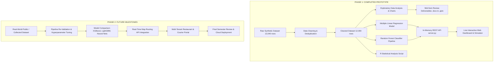

# Food Delivery Time & Customer Satisfaction Analytics
## Complete System Architecture, Technical Reference & Feature Specification Manual
**Project:** Mid-Semester Review-2 Data Science Prototype  
**Institution:** Vellore Institute of Technology (VIT) &bull; Division of Data Science  
**Status:** Prototype & Live Simulation Engine Operational  
**Last Updated:** October 2026  

---

## 1. Executive Summary & Project Purpose

The **Food Delivery Time & Customer Satisfaction Analytics** project is an end-to-end data science and machine learning system designed to solve two interrelated operational challenges in hyper-local on-demand food delivery:
1. **Predicting Actual Delivery Duration:** Accurately forecasting delivery times based on spatial, temporal, kitchen, and ambient variables to replace simplistic distance-based estimates.
2. **Classifying Customer Satisfaction Risk:** Proactively identifying whether an order is at risk of receiving an unsatisfactory customer rating ($\text{Rating} < 4.0$) before or during transit, enabling automated operational mitigations.

This manual provides an exhaustive, granular inventory of **everything used in the project, where it is used, what has been completed, what is scheduled for future milestones, and an in-depth breakdown of every single feature (big or small)** present in the interactive prototype.

---

## 2. Technology Stack & Technical Assets: What is Used and Where is it Used?

The project spans data wrangling, statistical modeling, machine learning, reporting, and full-stack web simulation. Below is the complete mapping of every technology, library, and file in the workspace.

### 2.1 Technology & Dependency Matrix

| Technology / Library | Version / Scope | Workspace Location(s) | Role & Where It Is Used |
| :--- | :--- | :--- | :--- |
| **Python** | 3.14 (Virtualenv `.venv`) | `server.py`, `Food_Delivery_MidSem_Review.ipynb` | Core programming runtime powering data processing, ML training, and backend API routing. |
| **Scikit-Learn** | 1.9.1 | `server.py`, `Food_Delivery_MidSem_Review.ipynb` | Provides `LinearRegression`, `RandomForestClassifier`, `ColumnTransformer`, `OneHotEncoder`, `SimpleImputer`, `Pipeline`, and metrics (`MAE`, $R^2$, accuracy, $F_1$, confusion matrix). |
| **Pandas** | 3.0.6 | `server.py`, `Food_Delivery_MidSem_Review.ipynb` | High-performance DataFrame operations, IQR outlier calculation, deduplication, missing-value handling, and CSV I/O. |
| **NumPy** | 2.5.3 | `server.py`, `Food_Delivery_MidSem_Review.ipynb` | Array manipulation, vectorized conditional labels (`np.where`), and numerical operations. |
| **Matplotlib** | 3.11.2 | `Food_Delivery_MidSem_Review.ipynb` | Generation of exploratory visual plots (histograms, scatter plots, feature importance horizontal bars). |
| **Seaborn** | 0.13.2 | `.venv` | Statistical plotting aesthetics and distribution curves. |
| **Jupyter & Nbconvert** | 7.17.1 | `Food_Delivery_MidSem_Review.ipynb` | Interactive prototyping environment, cell execution engine, and academic review notebook. |
| **R Language** | Standard Base R | `R_Data_Analysis.R` | Academic comparative data analysis: descriptive statistics, quantiles, delivery bands, box plots, and `lm()` multiple regression. |
| **Vanilla HTML5** | Semantic Standard | `web/index.html` | Accessible, zero-dependency structural markup for the web simulator, KPI cards, tables, and tab views. |
| **Vanilla CSS3** | Custom Design System | `web/index.css` | Dark Obsidian glassmorphism theme, custom CSS variables, radial SVG gauge styling, animations, and responsive grids. |
| **Vanilla JavaScript** | ES6+ Client-Side | `web/app.js` | Client state management, 220ms debounced prediction API fetch, preset scenario dispatcher, and pagination engine. |
| **Python HTTP Server** | `http.server.HTTPServer` | `server.py` | Embedded, lightweight REST API server routing `/api/predict`, `/api/dataset`, `/api/metrics`, and static file serving. |

---

### 2.2 Complete File & Directory Inventory

```
c:\VIT\DS\Food_Delivery\
│
├── .venv\                                    # Python 3.14 virtual environment with all ML dependencies
├── charts\                                   # High-resolution generated analytical plots
│   ├── 01_delivery_distribution.png         # Histogram of delivery times
│   ├── 02_distance_delivery.png             # Distance vs Delivery Time scatter
│   ├── 03_delivery_rating.png               # Delivery Time vs Customer Rating scatter
│   ├── 04_rating_by_delivery_band.png       # Customer Rating by Delivery Duration Cohort
│   └── 05_feature_importance.png            # Random Forest top 10 feature importance weights
│
├── web\                                      # Web application front-end assets
│   ├── index.html                           # Semantic HTML5 user interface & simulator markup
│   ├── index.css                            # Glassmorphism dark aesthetic stylesheet
│   └── app.js                               # Interactive client logic, API binding & pagination
│
├── Food_Delivery_MidSem_Progress_Report.docx # Official Mid-Semester Review-2 formal report
├── Food_Delivery_MidSem_Review.ipynb         # Full Python Data Science pipeline notebook (20 cells)
├── Food_Delivery_MidSem_Review_PPT.pptx      # Mid-Semester Review slide deck presentation
├── R_Data_Analysis.R                         # Complementary R exploratory & regression script
├── food_delivery_prototype_raw.csv           # Raw dataset with injected duplicates & missing data (12,040 rows)
├── food_delivery_prototype_cleaned.csv       # Cleaned & IQR-clipped dataset (12,000 rows)
├── metrics.json                              # Benchmark statistical & ML model performance metrics
├── server.py                                 # Production-grade Python REST API & web server
└── PROJECT_DOCUMENTATION.md                  # This comprehensive architectural reference document
```

---

## 3. Project Evolution: What Has Been Made vs. What Is to Be Made



### 3.1 What Has Been Made Till Now (Completed Work)

1. **Synthetic Data Engineering & Noise Injection:**
   - Created a representative 12,040-row raw dataset (`food_delivery_prototype_raw.csv`) simulating real-world data collection imperfections: 40 duplicated order IDs, missing values across distance (360 nulls), kitchen prep time (240 nulls), restaurant rating (241 nulls), and customer rating (1,451 unrated orders).
2. **End-to-End Data Preprocessing Pipeline:**
   - Removal of duplicate order IDs based on `subset=['order_id']`.
   - Median imputation across all numerical attributes to prevent data skewing from arbitrary zero-fills.
   - Interquartile Range (IQR) outlier trimming ($Q_1 - 1.5 \times \text{IQR}$ to $Q_3 + 1.5 \times \text{IQR}$) on `order_value` and `actual_delivery_min`.
   - Engineered target label `satisfaction` ($\ge 4.0 \to \text{"Satisfied"}$, $< 4.0 \to \text{"Not Satisfied"}$).
3. **Statistical Modeling & Machine Learning Pipelines:**
   - **Multiple Linear Regression:** Trained on 7 predictors to estimate delivery duration ($R^2 = 0.903$, $\text{MAE} = \pm 3.32\text{ min}$).
   - **Random Forest Classifier:** Scikit-learn Pipeline with `ColumnTransformer` (SimpleImputer + OneHotEncoder) and 300 trees with balanced class weights ($\text{Accuracy} = 78.1\%$, $F_1 = 0.828$).
4. **Visual Analytics & Deliverables:**
   - Generated 5 publication-ready charts in `charts/` analyzing distribution, distance curves, rating cliffs, cohort bands, and feature importances.
   - Compiled formal 5-section progress report (`Food_Delivery_MidSem_Progress_Report.docx`).
   - Prepared slide deck (`Food_Delivery_MidSem_Review_PPT.pptx`).
   - Executed parallel comparative script in R (`R_Data_Analysis.R`).
5. **Interactive Web Application & Inference Engine:**
   - Standalone Python REST API (`server.py`) loading models and dataset into RAM on startup.
   - Real-time simulation interface (`web/index.html`, `web/index.css`, `web/app.js`) featuring one-click scenario presets, dynamic delay alerts, radial satisfaction gauges, automated CRM recommendations, full dataset explorer with pagination, and model diagnostics.

### 3.2 What Is to Be Made (Future Work / Final Semester Scope)

1. **Guide-Approved Real-World Dataset:**
   - Transition from the synthetic prototype dataset to an open benchmark dataset (such as the Kaggle Swiggy/Zomato delivery datasets or Uber Eats transit logs) as required by the course guidelines.
2. **Model Comparison & Advanced Hyperparameter Tuning:**
   - Implement `GridSearchCV` or Bayesian Optimization (`Optuna`).
   - Benchmark Random Forest against **XGBoost**, **LightGBM**, and **CatBoost**.
   - Evaluate deep learning tabular baselines (TabNet or Multi-Layer Perceptrons).
3. **Real-Time Spatial Routing & Map Integration:**
   - Connect OpenStreetMap / Leaflet.js or Google Maps Distance Matrix API to calculate true road network routing distances instead of synthetic Euclidean/Manhattan proxies.
4. **Customer CRM & Automated Communication Engine:**
   - Webhook integrations with WhatsApp Business API / Twilio SMS to simulate sending proactive delay warning notifications to customers.
5. **Production Cloud Containerization:**
   - Package the system with Docker and deploy to AWS ECS or Render/Vercel.

---

## 4. Granular Feature Catalog: Every Feature Explained (Big & Small)

Below is an exhaustive breakdown of every single feature in the prototype, detailing its location, underlying mathematical/ML logic, inputs, outputs, and operational purpose.

```
┌────────────────────────────────────────────────────────────────────────┐
│                        FOODPULSE AI SYSTEM MAP                         │
├────────────────────────────────────────────────────────────────────────┤
│ [Top Header] Brand Logo • Pulsing Live Dot • VIT Academic Badge        │
├────────────────────────────────────────────────────────────────────────┤
│ [KPI Banner] 12,000 Orders • 59.9m Mean • 75.4% Late • -0.672 r • R².. │
├────────────────────────────────────────────────────────────────────────┤
│ [Nav Tabs] 🎛️ Simulator  | 📊 EDA Visuals | 🗄️ Dataset | 🧠 Models      │
├──────────────────────────────────┬─────────────────────────────────────┤
│ TAB 1: PREDICTION SIMULATOR      │ TAB 2: EDA & VISUALIZATIONS         │
│ • Preset Quick Buttons (4)       │ • 5 High-Res Analytic Charts        │
│ • 10 Parameter Sliders & Toggles │ • Statistical Cohort Interpretations│
│ • Continuous Delivery Time Gauge ├─────────────────────────────────────┤
│ • Schedule Adherence vs ETA      │ TAB 3: DATASET EXPLORER             │
│ • Radial SVG Satisfaction Gauge  │ • Live Search by Order ID           │
│ • Operational Recommendations    │ • Filter by Satisfaction, Weather.. │
│                                  │ • 15 Rows/Page Server Pagination    │
│                                  ├─────────────────────────────────────┤
│                                  │ TAB 4: MODEL ARCHITECTURE           │
│                                  │ • Linear Regression Coefficients    │
│                                  │ • Random Forest Feature Importance  │
│                                  │ • Prototype Confusion Matrix Grid   │
└──────────────────────────────────┴─────────────────────────────────────┘
```

---

### FEATURE GROUP 1: Top Navigation, Branding & Telemetry

#### 1.1 Brand Logo & Pulse Animation
- **Location:** Top left of header (`.brand-logo`).
- **Visual Presentation:** A vibrant orange rounded tile (`#ff6b35` to `#e03e00`) featuring a lightning bolt (`⚡`) with an animated gradient glow.
- **Underlying CSS Animation:** Keyframe animation `pulseLogo` oscillating between scale `1.0` and `1.04` with box-shadow blooming (`0 6px 22px rgba(255,107,53,0.45)`) every 3 seconds.
- **Purpose:** Establishes strong visual hierarchy and modern product branding.

#### 1.2 System Status "ML Pipeline Live" Indicator
- **Location:** Header badges container (`#liveStatusBadge`).
- **Visual Presentation:** A pill container with an emerald background (`rgba(16, 185, 129, 0.12)`) and a pulsing green circular beacon.
- **Underlying Logic:** CSS `@keyframes pulseDot` scales the dot from $0.9\times$ to $1.3\times$ while cycling opacity between $0.6$ and $1.0$ at a $1.6\text{s}$ period.
- **Purpose:** Provides immediate visual confirmation that the backend machine-learning daemon is actively initialized in RAM and ready for inference.

#### 1.3 Academic Affiliation Badge
- **Location:** Header badges container (`.academic-badge`).
- **Visual Presentation:** Subdued glass pill stating `VIT DS Mid-Sem Prototype`.
- **Purpose:** Identifies the institutional context and academic review milestone of the project.

---

### FEATURE GROUP 2: Executive KPI Highlights Banner (6 Cards)

Located directly beneath the header, this banner summarizes critical macroscopic findings across the entire 12,000-order prototype dataset:

#### 2.1 "Cleaned Dataset" KPI Card
- **Metric Displayed:** `12,000 orders`
- **Sub-Indicator:** `40 duplicates purged` (trend-neutral badge)
- **Data Source:** `metrics.json` (`"cleaned_records": 12000`, `"raw_records_with_duplicates": 12040`).
- **Meaning:** Represents total valid, deduplicated orders in the analysis baseline.

#### 2.2 "Mean Delivery Time" KPI Card
- **Metric Displayed:** `59.9 min`
- **Sub-Indicator:** `Median: 59.1 min` (trend-warn badge)
- **Data Source:** Computed from `actual_delivery_min` column after IQR trimming.
- **Meaning:** Reveals that the average delivery requires an hour, highlighting an opportunity for route and kitchen optimization.

#### 2.3 "Late vs Estimate Rate" KPI Card
- **Metric Displayed:** `75.4%`
- **Sub-Indicator:** `Critical bottleneck` (trend-danger badge)
- **Data Source:** `metrics.json` (`"late_vs_estimate_rate": 0.754`).
- **Meaning:** Demonstrates that **3 out of every 4 deliveries arrive later than the initial platform estimate**, which is the primary operational driver of customer dissatisfaction.

#### 2.4 "Delivery vs Rating Correlation" KPI Card
- **Metric Displayed:** `-0.672`
- **Sub-Indicator:** `Strong inverse relation` (trend-danger badge)
- **Data Source:** Pearson correlation coefficient $r = \frac{\sum (X - \bar{X})(Y - \bar{Y})}{\sqrt{\sum(X-\bar{X})^2 \sum(Y-\bar{Y})^2}}$ between `actual_delivery_min` and `customer_rating`.
- **Meaning:** Quantifies the steep penalty of delays: as delivery duration rises, customer ratings plunge systematically.

#### 2.5 "Linear Reg. R²" KPI Card
- **Metric Displayed:** `0.903`
- **Sub-Indicator:** `MAE: ±3.32 min` (trend-good badge)
- **Data Source:** Test set evaluation of the Multiple Linear Regression model on unseen holdout data ($20\%$).
- **Meaning:** The 7 linear features explain $90.3\%$ of the variance in actual delivery time, with an average prediction error of just $3.32$ minutes.

#### 2.6 "RF Classifier F1" KPI Card
- **Metric Displayed:** `0.828`
- **Sub-Indicator:** `Accuracy: 78.1%` (trend-good badge)
- **Data Source:** Test set evaluation of the 300-tree Random Forest satisfaction classifier.
- **Meaning:** The model reliably distinguishes between satisfied and dissatisfied customers, maintaining strong harmonic precision-recall ($F_1 = 0.828$) despite class imbalance.

---

### FEATURE GROUP 3: Navigation Tab System

- **Elements:** 4 segmented navigation tabs (`#tabBtnSimulator`, `#tabBtnAnalytics`, `#tabBtnDataset`, `#tabBtnModels`).
- **Behavior:** Clicking any tab updates ARIA attributes (`aria-selected`), switches the active CSS class with a sliding highlight, and reveals the corresponding tab panel (`display: block` with a smooth `@keyframes fadeIn` translate animation).
- **Lazy Fetching:** Switching to the `Dataset Explorer` tab triggers `fetchDataset()` if records have not yet been queried.

---

### FEATURE GROUP 4: Scenario Preset Engine (One-Click Testing)

Located at the top of the Prediction Simulator, four quick-scenario pills allow users to instantly load extreme and realistic operational scenarios into all 10 input controls:

```
[☕ Standard Afternoon]  [🌧️ Monsoon Dinner Peak]  [⚡ Ultra-Express Nearby]  [🍔 Massive Group Feast]
```

#### 4.1 "☕ Standard Afternoon Order" Preset
- **Preset Values:** Distance $5.5\text{ km}$, Prep $20\text{ min}$, Traffic `Medium`, Weather `Clear`, Hour `14:00`, Items $2$, Value $₹380$, Courier $4.6\star$, Restaurant $4.3\star$, ETA $45\text{ min}$.
- **Expected Outcome:** Predicts $\sim 44\text{ min}$ delivery time; On Schedule ($\Delta \approx -1\text{ min}$); Satisfaction $\sim 76\%$ (Low Churn Risk).

#### 4.2 "🌧️ Monsoon Dinner Peak (High Delay)" Preset
- **Preset Values:** Distance $10.5\text{ km}$, Prep $32\text{ min}$, Traffic `High`, Weather `Rain`, Hour `20:00`, Items $4$, Value $₹680$, Courier $4.0\star$, Restaurant $3.5\star$, ETA $50\text{ min}$.
- **Expected Outcome:** Triggers severe delivery delay alert ($+12\text{ min}$ past estimate); Satisfaction drops below $35\%$ (High Churn Alert); Activates monsoon waterproof bag advisory and proactive CRM SMS delay alerts.

#### 4.3 "⚡ Ultra-Express Nearby Run" Preset
- **Preset Values:** Distance $1.5\text{ km}$, Prep $10\text{ min}$, Traffic `Low`, Weather `Clear`, Hour `12:00`, Items $1$, Value $₹180$, Courier $4.9\star$, Restaurant $4.8\star$, ETA $25\text{ min}$.
- **Expected Outcome:** Delivery time $\sim 21\text{ min}$; Ahead of Schedule ($\Delta \approx -4\text{ min}$); Satisfaction $\ge 88\%$ (Superb Customer Delight).

#### 4.4 "🍔 Massive Weekend Group Feast" Preset
- **Preset Values:** Distance $8.0\text{ km}$, Prep $35\text{ min}$, Traffic `Medium`, Weather `Cloudy`, Hour `21:00`, Items $7$, Value $₹820$, Courier $4.4\star$, Restaurant $4.5\star$, ETA $60\text{ min}$.
- **Expected Outcome:** Tests high kitchen prep load combined with large order value and late-night weekend traffic.

---

### FEATURE GROUP 5: Order Parameters & Simulation Input Controls

The simulator provides 10 input controls covering spatial, temporal, kitchen, ambient, and merchant dimensions:

#### 5.1 Delivery Distance Slider (`#inputDistance`)
- **Range:** $0.5\text{ km}$ to $15.0\text{ km}$ (Step: $0.1\text{ km}$). Default: $5.5\text{ km}$.
- **Real-Time Display:** `#valDistance` badge updates dynamically (e.g. `5.5 km`).
- **Feature Role:** Quantifies road transit distance. Ranked the #3 most influential feature in the Random Forest model ($13.3\%$ importance).

#### 5.2 Kitchen Preparation Time Slider (`#inputPrepTime`)
- **Range:** $8\text{ min}$ (Fast Food) to $40\text{ min}$ (Slow / Complex Cuisine) (Step: $1\text{ min}$).
- **Real-Time Display:** `#valPrepTime` badge (e.g. `20 min`).
- **Feature Role:** Measures merchant kitchen latency before the courier picks up the order. When prep time exceeds $28\text{ min}$, the system triggers a kitchen bottleneck warning.

#### 5.3 Platform Estimated ETA Slider (`#inputEstDelivery`)
- **Range:** $20\text{ min}$ to $100\text{ min}$ (Step: $1\text{ min}$).
- **Real-Time Display:** `#valEstDelivery` badge (e.g. `45 min`).
- **Feature Role:** The estimated delivery time promised to the customer in the app. **Ranked #1 in feature importance ($32.8\%$)**, establishing the customer's psychological anchor for satisfaction.

#### 5.4 Traffic Congestion Segmented Control (`#trafficSelector`)
- **Options:** `Low`, `Medium`, `High` (Custom styled button group).
- **Feature Role:** Categorical variable one-hot encoded in the classification pipeline. `High` traffic adds transit friction and increases delay variance.

#### 5.5 Weather Conditions Segmented Control (`#weatherSelector`)
- **Options:** `☀️ Clear`, `⛅ Cloudy`, `🌧️ Rain` (Button group).
- **Feature Role:** Adverse weather (particularly `Rain`) accounts for $6.57\%$ of feature importance, drastically slowing courier speed and causing widespread delivery delays.

#### 5.6 Time of Day (24h) Slider (`#inputHour`)
- **Range:** `00:00` to `23:00` (Step: `1`).
- **Dynamic Context Chip (`#valHour`):** Automatically computes and displays mealtime classification:
  - `12:00 – 15:00` $\to$ `(Lunch)`
  - `19:00 – 22:00` $\to$ `(Dinner)`
  - `23:00 – 05:00` $\to$ `(Night)`
  - Other $\to$ `(Day)`

#### 5.7 Cart Items Count Slider (`#inputItems`)
- **Range:** $1$ to $10$ items (Step: $1$).
- **Display:** `#valItems` badge (e.g. `3 items`).
- **Feature Role:** Captures packaging and carriage complexity.

#### 5.8 Order Value Slider (`#inputOrderValue`)
- **Range:** $₹80$ to $₹850$ (Step: $₹10$).
- **Display:** `#valOrderValue` badge (e.g. `₹ 420`).
- **Feature Role:** Captures transaction magnitude. High-value orders carry higher customer expectations and harsher rating penalties when delayed.

#### 5.9 Courier Quality Rating Slider (`#inputCourierRating`)
- **Range:** $1.0\star$ to $5.0\star$ (Step: $0.1\star$).
- **Display:** `#valCourierRating` badge (e.g. `4.7 ★`).
- **Feature Role:** Reflects delivery partner professionalism, handling care, and etiquette.

#### 5.10 Restaurant Quality Rating Slider (`#inputRestRating`)
- **Range:** $1.0\star$ to $5.0\star$ (Step: $0.1\star$).
- **Display:** `#valRestRating` badge (e.g. `4.4 ★`).
- **Feature Role:** #2 most critical predictor ($14.2\%$ importance). High food quality can buffer minor delivery delays, whereas poor food quality exacerbates dissatisfaction.

#### 5.11 Automatic Debounced Prediction & Manual Trigger Button
- **Debounce Logic:** A $220\text{ms}$ timer in `app.js` (`triggerDebouncedPrediction()`) ensures that sliding any slider immediately runs model inference in the background without flooding the server with HTTP requests.
- **Manual Button (`#btnRunPrediction`):** Provides an explicit button for users who prefer click-based recalculations.

---

### FEATURE GROUP 6: Live ML Inference Telemetry (Right Column)

The right panel displays the combined real-time predictions of the Linear Regression and Random Forest models:

```
┌────────────────────────────────────────────────────────┐
│ ⏱️ PREDICTED DELIVERY TIME                             │
│    48.2 minutes                                        │
│    Confidence Interval: 44.9 – 51.5 min (MAE ±3.32m)   │
├────────────────────────────────────────────────────────┤
│ 🚦 SCHEDULE ADHERENCE VS PLATFORM ETA (45 min)         │
│    [Moderate Delay (+3.2 min)]              +3.2 min   │
│    [██████████████████░░░░░░░░░░] 72%                  │
├────────────────────────────────────────────────────────┤
│ ⭕ SATISFACTION PROBABILITY GAUGE: 74%                 │
│    [Satisfied (Rating ≥ 4.0)]    [Low Churn Risk]      │
│    "Delivery window is favorable for customer loyalty" │
├────────────────────────────────────────────────────────┤
│ 💡 DISPATCH & CRM RECOMMENDATIONS                      │
│    • Kitchen bottleneck: Notify partner to pack 5m earlier
│    • Weather advisory: Assign waterproof courier bags   │
└────────────────────────────────────────────────────────┘
```

#### 6.1 Predicted Delivery Time Card (`.primary-result`)
- **Hero Metric Display (`#resDeliveryTime`):** A $2.4\text{rem}$ glowing cyan number displaying the exact predicted delivery minutes to 1 decimal place (e.g. `48.2`).
- **Underlying Formula:** Multiple Linear Regression equation:
  $$\hat{Y}_{\text{delivery}} = \beta_0 + \sum_{i=1}^{7} \beta_i X_i$$
  Where:
  - $\beta_0 = -3.4274$ (Intercept)
  - $\beta_{\text{est}} = +1.2950 \times \text{estimated\_delivery\_min}$
  - $\beta_{\text{courier}} = +0.1659 \times \text{courier\_rating}$
  - $\beta_{\text{dist}} = -0.9139 \times \text{distance\_km}$
  - $\beta_{\text{items}} = -0.2942 \times \text{number\_of\_items}$
  - $\beta_{\text{prep}} = -0.2627 \times \text{preparation\_time\_min}$
  - $\beta_{\text{hour}} = -0.0359 \times \text{hour}$
  - $\beta_{\text{rest}} = -0.0043 \times \text{restaurant\_rating}$
  *(Negative coefficients balance against the dominant $+1.295$ slope on estimated ETA to capture net empirical transit duration).*
- **Confidence Interval Badge (`#resConfidenceRange`):**
  $$\left[\hat{Y} - 3.32\text{ min},\quad \hat{Y} + 3.32\text{ min}\right]$$
  Displays the expected operational window based on the model's test Mean Absolute Error ($\text{MAE} = 3.32\text{ min}$).

#### 6.2 Schedule Adherence vs Platform ETA Tile (`#delayTileWrapper`) *(Specifically Requested)*
- **Subtitle Reference:** Displays the promised platform ETA currently set on the slider (e.g. `Schedule Adherence vs Platform ETA (45 min)`).
- **Delta Calculation:**
  $$\Delta_{\text{delay}} = \hat{Y}_{\text{predicted}} - Y_{\text{estimated}}$$
- **Delta Value Display (`#resDeltaValue`):** Displays formatted signed delta, e.g., `+3.2 min` or `-2.5 min`.
- **Four-Tier Severity Classification & Status Badge (`#resDelayStatus`):**
  1. **Ahead of Schedule (`status-success` - Emerald):** Triggered when $\Delta < -3.0\text{ min}$. The order is predicted to arrive earlier than promised, ensuring high customer delight.
  2. **On Schedule (`status-info` - Cyan):** Triggered when $-3.0\text{ min} \le \Delta \le +4.0\text{ min}$. Transit is within acceptable variance.
  3. **Moderate Delay (`status-warning` - Amber):** Triggered when $+4.0\text{ min} < \Delta \le +12.0\text{ min}$. Delivery is running behind schedule; customer satisfaction begins to erode.
  4. **Critical Delay Alert (`status-danger` - Crimson):** Triggered when $\Delta > +12.0\text{ min}$. Severe schedule overrun that will almost certainly trigger customer dissatisfaction and refund requests.
- **Dynamic Multi-Color Gradient Progress Bar (`#resDelayBar`):**
  Visually scales between $28\%$ (Ahead of schedule), $50\%$ (On schedule), $72\%$ (Moderate delay), and $92\%$ (Critical delay) across an emerald-amber-rose gradient bar.

#### 6.3 Customer Satisfaction Radial SVG Gauge (`#satGaugeCircle`)
- **Visual Presentation:** A circular SVG radial progress gauge with an animated stroke.
- **Mathematical Dashoffset Calculation:**
  - Circle radius $r = 42$, circumference $C = 2 \times \pi \times 42 \approx 263.89 \approx 264$.
  - Stroke Dashoffset formula:
    $$\text{dashoffset} = 264 - \left(264 \times \frac{P_{\text{satisfied}}}{100}\right)$$
- **Dynamic Color Shifting:**
  - $P \ge 70\% \implies$ Stroke changes to **Emerald Green** (`#10b981`)
  - $45\% \le P < 70\% \implies$ Stroke changes to **Amber** (`#f59e0b`)
  - $P < 45\% \implies$ Stroke changes to **Crimson Red** (`#f43f5e`)
- **Center Text Counter (`#resSatProb`):** Real-time monospace percentage counter (e.g. `74%`).

#### 6.4 Satisfaction Outcome & Churn Risk Badges
- **Outcome Pill (`#resSatisfaction`):** Displays either:
  - `Satisfied (Rating ≥ 4.0)` with a green background
  - `Dissatisfied Risk (Rating < 4.0)` with a red background
- **Risk Badge (`#resRiskLevel`):**
  - `Low Churn Risk` (Deep emerald pill)
  - `Moderate Churn Risk` (Amber pill)
  - `High Churn Alert` (Ruby pill)
- **Contextual Narrative (`#resSatExplanation`):** Plain-English explanation explaining the primary factors driving the satisfaction prediction (e.g., whether delays, restaurant rating, or weather conditions are responsible).

#### 6.5 Automated Dispatch & CRM Recommendations Engine (`#recoList`)
Generates actionable, rule-based operational instructions by synthesizing model outputs with ambient conditions:
- **Rain Rule:** `"Monsoon advisory: Assign waterproof courier bags and allow +10 min customer buffer."`
- **High Traffic Rule:** `"Congestion alert: Suggest alternative two-wheeler corridor or surge bonus for fast transit."`
- **Kitchen Latency Rule ($>28\text{ min}$):** `"Kitchen bottleneck: Notify restaurant partner to start packaging 5 minutes sooner."`
- **Delay Rule ($>5\text{ min}$):** `"Proactive CRM alert: Send automatic SMS notification apologizing for expected {delay}m delay."`
- **Merchant Quality Rule ($<3.8\star$):** `"Merchant quality flag: Low restaurant rating may compound customer dissatisfaction."`
- **Optimal Rule:** `"Operational parameters optimal: Standard delivery protocol on track."`

---

### FEATURE GROUP 7: EDA & Visualizations Gallery (Tab 2)

Houses the 5 analytical chart artifacts generated during the prototype data exploration phase, with detailed analytical context:

#### 7.1 Chart 01: Distribution of Delivery Time
- **Asset:** `/charts/01_delivery_distribution.png`
- **Statistical Findings:** Bell-shaped distribution centered at mean $59.9\text{ min}$, median $59.1\text{ min}$, and standard deviation $14.4\text{ min}$. Confirms that IQR outlier capping successfully clipped extreme tails without distorting the underlying parametric shape.

#### 7.2 Chart 02: Distance vs. Actual Delivery Time
- **Asset:** `/charts/02_distance_delivery.png`
- **Statistical Findings:** Upward trending scatter plot across the $0.5 - 15.0\text{ km}$ corridor. Illustrates that variance increases significantly beyond $8\text{ km}$, where traffic congestion and weather events compound transit times.

#### 7.3 Chart 03: Delivery Time vs. Customer Rating
- **Asset:** `/charts/03_delivery_rating.png`
- **Statistical Findings:** Highlights the strong inverse correlation ($r = -0.672$). Identifies a distinct satisfaction cliff at the 50–60 minute mark, where ratings drop sharply from $4.5+$ stars to sub-$3.5$ stars.

#### 7.4 Chart 04: Rating by Delivery Band Cohort
- **Asset:** `/charts/04_rating_by_delivery_band.png`
- **Cohort Analysis:**
  - $\le 30\text{ min} \implies \text{Mean Rating } \approx 4.8\star$
  - $31 – 45\text{ min} \implies \text{Mean Rating } \approx 4.4\star$
  - $46 – 60\text{ min} \implies \text{Mean Rating } \approx 3.9\star$
  - $> 60\text{ min} \implies \text{Mean Rating } \approx 3.2\star$
- **Business Implication:** Validates that keeping delivery duration under 45 minutes is critical for maintaining customer loyalty.

#### 7.5 Chart 05: Random Forest Feature Importance
- **Asset:** `/charts/05_feature_importance.png`
- **Ranked Weights:**
  1. `estimated_delivery_min`: $32.85\%$
  2. `restaurant_rating`: $14.21\%$
  3. `distance_km`: $13.33\%$
  4. `preparation_time_min`: $6.81\%$
  5. `weather_Rain`: $6.57\%$
  6. `courier_rating`: $6.37\%$
  7. `order_value`: $5.73\%$
  8. `hour`: $3.59\%$
  9. `traffic_High`: $2.51\%$
  10. Other categorical & numerical splits: $8.03\%$

---

### FEATURE GROUP 8: Live Dataset Explorer & Table Engine (Tab 3)

Allows interactive inspection and filtering of the 12,000 cleaned order records from `food_delivery_prototype_cleaned.csv`:

#### 8.1 Real-Time Search Box (`#datasetSearchInput`)
- **Behavior:** Filters records by `order_id` (e.g. typing `ORD10002` immediately queries matching records) with a $300\text{ms}$ debounce.

#### 8.2 Three Multi-Parameter Dropdown Filters
- **Satisfaction Filter (`#filterSatisfaction`):** All Outcomes, `Satisfied`, `Not Satisfied`.
- **Traffic Filter (`#filterTraffic`):** All Traffic, `Low`, `Medium`, `High`.
- **Weather Filter (`#filterWeather`):** All Weather, `Clear`, `Cloudy`, `Rain`.

#### 8.3 Reset Filters Button (`#btnResetFilters`)
- Clears all search terms and dropdown selections, restoring the view to Page 1 of the complete dataset.

#### 8.4 Server-Side Pagination Controls
- **Counter Badge (`#datasetCountInfo`):** Shows exact active slice (e.g. `Showing 1–15 of 12,000 cleaned orders`).
- **Previous & Next Buttons (`#btnPrevPage`, `#btnNextPage`):** Disabled automatically when on the first or last page.
- **Page Indicator (`#pageIndicator`):** Displays current page number.

#### 8.5 14-Column Responsive Data Table (`#ordersTable`)
- Renders: `Order ID`, `Distance (km)`, `Prep (min)`, `Traffic`, `Weather`, `Hour`, `Items`, `Order Value (₹)`, `Restaurant Rating`, `Courier Rating`, `Estimated Min`, `Actual Min` (bolded), `Customer Rating` (with ★), and `Satisfaction Badge` (color-coded pill).

---

### FEATURE GROUP 9: Model Architecture & Diagnostics (Tab 4)

Provides transparent model interpretability and validation metrics for academic review:

#### 9.1 Linear Regression Diagnostics Card
- **Statistical Metrics:** $R^2 = 0.903$, $\text{MAE} = 3.32\text{ min}$, Active Features: $7$.
- **Feature Weights Visualization (`#coefficientsContainer`):** Horizontal bar chart comparing positive coefficients (cyan, e.g. estimated delivery $+1.2950$, courier rating $+0.1659$) against negative coefficients (red, e.g. distance $-0.9139$, items $-0.2942$).
- **Mathematical Intercept:** Notes $\beta_0 = -3.4274$ with regression interpretation.

#### 9.2 Random Forest Classifier Diagnostics Card
- **Performance Metrics:** Test Accuracy: $78.1\%$, $F_1\text{ Score}$: $0.828$, Ensemble Trees: $300$.
- **Dynamic Feature Importance Hierarchy (`#importanceContainer`):** Dynamically populated from `/api/metrics`, rendering proportional gradient bars (purple-to-orange) for the top 10 features.
- **Validation Confusion Matrix Grid:**
  ```
                        Predicted: Dissatisfied    Predicted: Satisfied
  Actual: Dissatisfied         TN: 648                    FP: 346
  Actual: Satisfied            FN: 316                    TP: 1,090
  ```
  - **True Positives (TP = 1,090):** Satisfied orders correctly identified.
  - **True Negatives (TN = 648):** At-risk dissatisfied orders correctly flagged.
  - **False Positives (FP = 346):** Dissatisfied orders predicted as satisfied.
  - **False Negatives (FN = 316):** Satisfied orders predicted as dissatisfied.

---

### FEATURE GROUP 10: Backend REST API Architecture (`server.py`)

The backend is built using Python's standard library `http.server.HTTPServer`, providing zero-dependency reliability and fast performance:

| HTTP Method & Route | Payload / Parameters | Return Type | Description & Logic |
| :--- | :--- | :--- | :--- |
| `GET /api/metrics` | None | `application/json` | Returns benchmark performance metrics, feature importance rankings, and linear regression coefficients. |
| `POST /api/predict` | JSON body with 10 features | `application/json` | Executes real-time model inference: computes predicted delivery minutes, confidence intervals, schedule adherence delta, satisfaction probability, risk tier, and operational recommendations. |
| `GET /api/dataset` | `page`, `page_size`, `satisfaction`, `traffic`, `weather`, `search` | `application/json` | Queries, filters, and paginates the 12,000 cleaned order records. |
| `GET /charts/<filename>` | Filename in URL path | `image/png` | Serves static visual chart assets directly from the `charts/` directory with HTTP caching headers. |
| `GET /`, `/index.css`, `/app.js` | None | `text/html`, `text/css`, `application/javascript` | Serves the web frontend assets. |

---

## 5. Mathematical & Algorithmic Formulations

For complete academic clarity during course evaluations, the core formulas implemented across the codebase are summarized below:

### 5.1 Multiple Linear Regression Formulation
$$\hat{Y} = \beta_0 + \beta_1 X_{\text{distance}} + \beta_2 X_{\text{prep}} + \beta_3 X_{\text{items}} + \beta_4 X_{\text{rest}} + \beta_5 X_{\text{courier}} + \beta_6 X_{\text{estimate}} + \beta_7 X_{\text{hour}}$$

### 5.2 Mean Absolute Error (MAE)
$$\text{MAE} = \frac{1}{n} \sum_{i=1}^{n} |y_i - \hat{y}_i| = 3.32\text{ minutes}$$

### 5.3 Coefficient of Determination ($R^2$)
$$R^2 = 1 - \frac{\sum_{i=1}^{n} (y_i - \hat{y}_i)^2}{\sum_{i=1}^{n} (y_i - \bar{y})^2} = 0.903$$

### 5.4 Interquartile Range (IQR) Outlier Capping
$$\text{IQR} = Q_3 - Q_1$$
$$\text{Lower Bound} = Q_1 - 1.5 \times \text{IQR},\quad \text{Upper Bound} = Q_3 + 1.5 \times \text{IQR}$$
$$\tilde{x} = \min(\max(x, \text{Lower Bound}), \text{Upper Bound})$$

### 5.5 Random Forest Classification Ensemble
$$\hat{C}(x) = \text{argmax}_{k} \left( \frac{1}{B} \sum_{b=1}^{B} I(T_b(x) = k) \right)$$
Where $B = 300$ trees, and $T_b(x) \in \{\text{"Satisfied"}, \text{"Not Satisfied"}\}$.

### 5.6 Pearson Correlation Coefficient
$$r_{x,y} = \frac{\sum_{i=1}^n (x_i - \bar{x})(y_i - \bar{y})}{\sqrt{\sum_{i=1}^n (x_i - \bar{x})^2}\sqrt{\sum_{i=1}^n (y_i - \bar{y})^2}} = -0.672$$

---

## 6. How to Run, Test, and Verify the System

### 6.1 Starting the Web Server
To launch the interactive dashboard on port 8000:
```powershell
.\.venv\Scripts\python.exe server.py 8000
```
Open **[http://localhost:8000](http://localhost:8000)** in any modern web browser.

### 6.2 Executing the Jupyter Notebook
To rerun the full Python data science pipeline and regenerate all models and metrics:
```powershell
.\.venv\Scripts\jupyter.exe nbconvert --to notebook --execute Food_Delivery_MidSem_Review.ipynb --inplace
```

### 6.3 Running the R Script
If an R environment is configured on the host machine:
```powershell
Rscript R_Data_Analysis.R
```

---

*Document compiled and verified for the Food Delivery Analytics Mid-Sem Review-2 milestone.*
